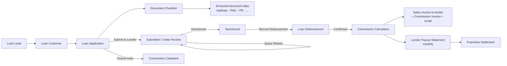

# DSA Loan Portal

A home-loan management app for a **DSA (Direct Selling Agent)**, built on **Frappe / ERPNext**.

A DSA brings home-loan customers to banks and housing-finance companies. When a lender disburses the loan, it pays the DSA a commission. This app follows that whole journey:

1. A **lead** comes in.
2. It becomes a **customer** and a **loan application** to a chosen lender.
3. The documents are collected and verified.
4. The application is submitted to the lender, which sanctions and disburses it.
5. The DSA's commission is calculated, invoiced, received and shared with franchise partners.

Most of the money side runs automatically.

---

## Contents

- [What it does](#what-it-does)
- [How a loan moves through the app](#how-a-loan-moves-through-the-app)
- [What happens automatically](#what-happens-automatically)
- [Roles and who sees what](#roles-and-who-sees-what)
- [The DocTypes](#the-doctypes)
- [Requirements](#requirements)
- [Installation](#installation)
- [Loading the master data](#loading-the-master-data)
- [First-time set-up checklist](#first-time-set-up-checklist)
- [Using it day to day](#using-it-day-to-day)
- [Scripts](#scripts)
- [Testing](#testing)
- [Project structure](#project-structure)
- [Documentation](#documentation)
- [Troubleshooting](#troubleshooting)
- [License](#license)

---

## What it does

| Area | What you get |
|---|---|
| **Lender set-up** | Lenders (banks and NBFCs) with their branches, loan products, schemes, interest rates and fees. For each lender: the documents it needs, commission slabs and the DSA's login IDs on its portals. |
| **Sales** | Leads, customers and co-applicants, and loan applications, each linked to a DSA branch, an agent and optionally a franchise. |
| **Documents** | A checklist built automatically from the lender's document rules, for every applicant. Each document is tracked from Pending through Received to Verified. The data read from each document (Aadhaar, PAN, address proof, bank statement, salary slip, ITR, Form 16) is stored in its own record. Aadhaar numbers are masked. |
| **Lender process** | Each step is a button with a short form: Submit to Lender, Query Raised, Sanctioned (amount, rate, tenure, valid-until), Record Disbursement (part or full). |
| **Commission** | Commission is calculated from the lender's slab when a disbursement is confirmed, with GST and TDS. A Sales Invoice is raised to the lender and emailed with its PDF. Monthly payout statements are reconciled against what the lender actually paid. Clawbacks are handled when a loan closes early. |
| **Franchises** | Franchise partners and their branches. Their share of the received commission is settled automatically. |
| **Access control** | Six roles. Each user sees only the records of their own DSA branch or franchise. |
| **Guided forms** | Every form shows a progress bar and one **next-step** button, plus "Go to" links to the related records. You never need to look for which form comes next. |

---

## How a loan moves through the app



**Application statuses:** Draft → Documents Pending → Ready for Submission → Submitted → Under Review → (Query Raised / On Hold) → Sanctioned → Partially Disbursed → Disbursed → Closed. An application can also end as Rejected or Withdrawn.

- **Partially Disbursed** and **Disbursed** can only be reached through a **confirmed Loan Disbursement**. They cannot be typed in by hand, so the commission can never be missed.
- A new Loan Disbursement is **Confirmed** by default.

---

## What happens automatically

| When this happens | The app does this |
|---|---|
| A Loan Application is created | Builds the Document Checklist from the lender's Document Rules, for every applicant. |
| A Loan Disbursement becomes **Confirmed** | Creates a **Commission Calculation** using the lender's slab (%, GST and TDS). |
| The application becomes **Disbursed**, and the lender has *Auto Invoice on Disbursement* ticked | Raises and submits an ERPNext **Sales Invoice** to the lender, with one line per commission. Creates a **Commission Invoice** and marks the commissions Invoiced. Emails the invoice PDF to the lender's *Invoice Email Group*. |
| The **1st of every month** (scheduler) | Creates a **Lender Payout Statement** for each lender with the expected amount filled in. A commission that arrives after a month was already reconciled goes on a top-up statement. |
| A payout statement is **Matched / Partially Matched** | Marks the commissions Paid / Partially Paid. Drafts the **Franchise Settlement** for that period. Drafts a **Debit Note** if the lender paid less than expected. |
| An application is **Closed** inside the slab's clawback window | Creates a **Commission Clawback**, then a draft **Credit Note**. |

Automation never blocks the save that triggered it. If something can't be created, the error is logged and shown as a message.

If no outgoing Email Account is set up, the invoice email is saved as **Email Pending**. You can send it later with **Lender Invoice → Send Invoice Email** on the application.

---

## Roles and who sees what

| Role | Can do |
|---|---|
| **DSA Admin** | Maintains the master data (lenders, products, schemes, rules, slabs, branches, franchises). Can read everything else. |
| **Branch Manager** | Full control of leads, customers, applications and documents in their branch. |
| **DSA Agent** | Creates leads, customers and applications, and uploads documents. Cannot delete applications or create commissions. |
| **Document Verifier** | Verifies document checklists and the extracted data. |
| **DSA Accounts** | Handles disbursements, commissions, invoices, payouts, clawbacks and franchise settlements. Cannot see PAN, Aadhaar or CIBIL details. |
| **Franchise Partner** | Works their own franchise's leads and applications, and reads their settlements. |

**Branch separation:** each user is given a *User Permission* on one or more **DSA Branches**. They then see only those branches' records in every list, report and link field. Users without any branch permission, such as head office, see everything.

To give access from code:

```python
from dsa_loan.dsa_loan_portal.access import grant_branch_access
grant_branch_access("user@example.com", dsa_branch="LFS-PUN-01")   # one branch
grant_branch_access("partner@example.com", franchise="KLP")         # a franchise and all of its branches
```

The roles are created automatically on install and on every migrate.

---

## The DocTypes

All 29 are in the module **DSA Loan Portal**.

| Group | DocTypes |
|---|---|
| **Masters** | Lender Type, Lender, Lender Branch, Loan Product, Loan Scheme, Commission Slab Structure, Lender Document Rule, Lender Login, Franchise, DSA Branch |
| **Sales** | Loan Lead, Loan Customer, Loan Application, Co-Applicant *(child table)* |
| **Documents** | Document Checklist, Document Checklist Item *(child table)*, Aadhaar Card Data, PAN Card Data, Address Proof Data, Bank Statement Data, Salary Slip Data, ITR Data, Form 16 Data |
| **Money** | Loan Disbursement, Commission Calculation, Commission Invoice, Lender Payout Statement, Commission Clawback, Franchise Settlement |

The app also uses these ERPNext records: **Company**, **Employee** (branch managers and agents), **Customer** (one for each lender), **Sales Invoice**, **Email Group** and **Email Template**.

---

## Requirements

- **Frappe Framework v16** and **ERPNext v16** on a working bench, with Python 3.10+, MariaDB, Redis and Node.
- A site with ERPNext installed and the **setup wizard finished**, so that the site has a Company.
- Optional: **wkhtmltopdf / Chromium** for invoice PDFs, and an outgoing **Email Account** to send invoices.

---

## Installation

```bash
cd ~/frappe-bench                                   # your bench folder
bench get-app https://github.com/naveedahmed918/dsa-loan-management-platform.git
bench --site <your-site> install-app dsa_loan
bench --site <your-site> migrate
bench build --app dsa_loan
bench restart                                       # or: bench start, in development
```

Installing creates the six roles, the "DSA Commission" item and the default invoice Email Template. Then log in as Administrator and open **DSA Loan Portal** from the sidebar.

To update later:

```bash
cd ~/frappe-bench/apps/dsa_loan && git pull
cd ~/frappe-bench && bench --site <your-site> migrate && bench build --app dsa_loan
```

---

## Loading the master data

The repository ships ready-made data in `sample_data/` (one JSON file per DocType). All people in it are fictional.

```bash
cd ~/frappe-bench/sites
../env/bin/python ../apps/dsa_loan/scripts/load_sample_data.py <your-site> --masters-only   # master data only
../env/bin/python ../apps/dsa_loan/scripts/load_sample_data.py <your-site>                  # master data + demo loans
```

| Option | What it loads | Records |
|---|---|---|
| `--masters-only` | 5 lender types, 6 lenders (SBI, HDFC, ICICI, Axis, Bank of Baroda, LIC HFL) with their branches, 32 loan products, 38 schemes, 122 document rules, 7 commission slabs, 5 franchises with 10 DSA branches, 8 lender logins, 20 customers and the demo employees they point to | 265 |
| *(none)* | The master data **plus** 14 demo loans covering every status, with their documents, disbursements, commissions, payouts, clawbacks and settlements | 481 |

- Records are loaded exactly as exported. The placeholder company is replaced with your site's company.
- Records that already exist are skipped, so it is **safe to run again**. You can load the masters now and the demo loans later.
- Loading does not run the automation: no commissions, invoices or emails are created.
- If anything fails, the whole load is rolled back.

> The commission percentages and clawback windows on the slabs are **samples**. Replace them with the terms you have agreed with each bank before relying on the numbers.

---

## First-time set-up checklist

1. **Company:** finish the ERPNext setup wizard.
2. **Master data:** load it as shown above, or enter your own lenders, products and slabs.
3. **GST:** run `scripts/setup_gst.py <site>`. It creates Output CGST / SGST / IGST accounts and the GST 18% templates for the lender invoices.
4. **Email:** add an outgoing **Email Account** (Settings → Email Account). Then add the real recipients to each lender's **Invoice Email Group** (Email Group Member).
   - An empty group means "send to nobody".
   - If no group is set on the lender, its Official Email is used.
5. **Employees and users:** create Employees for branch managers and agents, and Users with the right **role**. Give each user their branch with `grant_branch_access`.
6. **Scheduler:** make sure it is on (`bench --site <site> enable-scheduler`) so the monthly payout statements are created.
7. *(Optional)* **Demo users:** `scripts/create_demo_users.py <site>` creates one user per role. Their test passwords are written to `<bench>/demo_users.txt`. That file is outside the app and must never be committed.

---

## Using it day to day

1. **New Loan Lead.** Capture the enquiry, then use **Convert to Customer**.
2. **Loan Customer.** Fill in KYC, income and address, then use **New Loan Application**.
3. **Loan Application.** Choose the lender, product and scheme, and add any co-applicants. On save, the **Document Checklist** is created.
4. **Document Checklist.** Mark each document Received and attach the file. A Verifier marks it **Verified**. Enter the extracted data (PAN, Aadhaar, ITR and so on) from the linked forms.
5. Back on the application, the progress bar shows what is missing. Follow the next-step button:
   - **Submit to Lender:** lender reference number and date.
   - **Set Status → Query Raised / On Hold:** while the lender asks questions.
   - **Sanctioned:** sanctioned amount, rate, tenure and valid-until date.
   - **Record Disbursement:** amount and date. Repeat it for part disbursements.
6. Once the disbursement is confirmed, the **Commission Calculation** appears by itself. When the loan is fully disbursed, the **lender invoice** is raised and emailed.
7. At the start of each month, open the **Lender Payout Statement**, enter what the lender actually paid and mark it **Matched**. The commissions become Paid and the **Franchise Settlement** is drafted.
8. If a loan closes early, set the application to **Closed**. The clawback and credit note are created for you.

Every form has a **Go to** menu to jump to the linked records. The **Connections** panel shows everything related to a record.

---

## Scripts

Run them from the bench's `sites` folder:
```bash
../env/bin/python ../apps/dsa_loan/scripts/<script>.py <site>
```
Each script runs as one transaction and is safe to run again.

| Script | Purpose |
|---|---|
| `load_sample_data.py` | Loads `sample_data/`. Add `--masters-only` for the master data alone. |
| `setup_gst.py` | Creates the GST accounts and tax templates. Add `--reraise` to re-issue invoices that were raised without tax. |
| `create_demo_users.py` | Creates one demo user per role, limited to a branch or franchise. |
| `load_bank_rates.py` | Loads each bank's published rates and fees, with source links. |
| `seed_scenarios.py` | Generates a larger demo data set covering every status. |
| `import_atharva_master_data.py`, `fix_atharva_rules.py`, `fix_master_data.py` | Build the master data step by step from the original fixtures in `scripts/data/`. Not needed if you use `load_sample_data.py`. |
| `e2e_flow_test.py` | The end-to-end test (see below). |

More detail: [scripts/README.md](scripts/README.md).

---

## Testing

```bash
cd ~/frappe-bench/sites
../env/bin/python ../apps/dsa_loan/scripts/e2e_flow_test.py <your-site>
```

This walks a complete loan from lead to disbursement, then commission, invoice, payout, clawback and franchise settlement, and checks the role permissions. It prints PASS or FAIL for every check. Everything runs in one transaction that is **rolled back**, so your data is untouched.

---

## Project structure

```
dsa_loan/
├── dsa_loan/
│   ├── hooks.py                     # install/migrate hooks, monthly scheduler, doc events
│   ├── dsa_loan_portal/
│   │   ├── doctype/                 # the 29 DocTypes (JSON + Python controller + form JS)
│   │   ├── access.py                # roles and branch/franchise permissions
│   │   ├── automation.py            # commission, payout, settlement, clawback automation
│   │   ├── invoicing.py             # Sales Invoice + email to the lender
│   │   ├── flow.py                  # APIs behind the guided next-step buttons
│   │   ├── document_data.py         # extracted document data helpers
│   │   └── page/                    # dashboard pages
│   ├── patches/                     # data migrations run by `bench migrate`
│   └── public/                      # JS / CSS assets
├── sample_data/                     # exported demo data + manifest.json
├── scripts/                         # set-up, data loading and test scripts
├── dev_tools/                       # DocType generator, exporters, PDF builders, site audit
└── docs/                            # reference PDFs
```

**For developers:**
- DocTypes are generated from `dev_tools/generate_doctypes.py`. That file is the single source of truth for fields, permissions (`ACCESS`) and connections. Edit it, regenerate, then run `bench migrate`; don't edit the DocType JSON by hand.
- Run `dev_tools/export_sample_data.py <site>` to refresh `sample_data/` from a site.
- `dev_tools/audit_site.py` checks that the site matches the spec.

See [dev_tools/README.md](dev_tools/README.md).

---

## Documentation

The `docs/` folder has:

| File | Contents |
|---|---|
| `DSA_Loan_1_Database_Diagram.pdf` | How the DocTypes link to each other |
| `DSA_Loan_2_Data_Entry_Guide.pdf` | Step-by-step data entry for each form |
| `DSA_Loan_3_How_It_Was_Built.pdf` | Design decisions and architecture |
| `DSA_Loan_Final_DocType_Fields.pdf` | Every field of every DocType |
| `DSA_Document_Data_Fields.pdf` | The fields captured from each KYC / income document |

---

## Troubleshooting

| Problem | Fix |
|---|---|
| `This site has no Company yet` when loading data | Finish the ERPNext setup wizard first. |
| No commission after a disbursement | The disbursement must be **Confirmed**, and the lender needs an active **Commission Slab Structure** that covers the loan amount and date. |
| Invoice not emailed (status *Email Pending*) | Add an outgoing Email Account, then use **Lender Invoice → Send Invoice Email**. |
| Invoice email goes to nobody | The lender's Invoice Email Group has no members. |
| Invoice has no GST | Run `scripts/setup_gst.py <site> --reraise`. |
| Monthly payout statements not appearing | Enable the scheduler: `bench --site <site> enable-scheduler`. |
| A user can't see records | Give them a DSA Branch with `grant_branch_access`, and check their role. |
| Form changes not showing | Run `bench build --app dsa_loan` and `bench --site <site> clear-cache`, then hard-refresh the browser. |

---

## License

MIT
